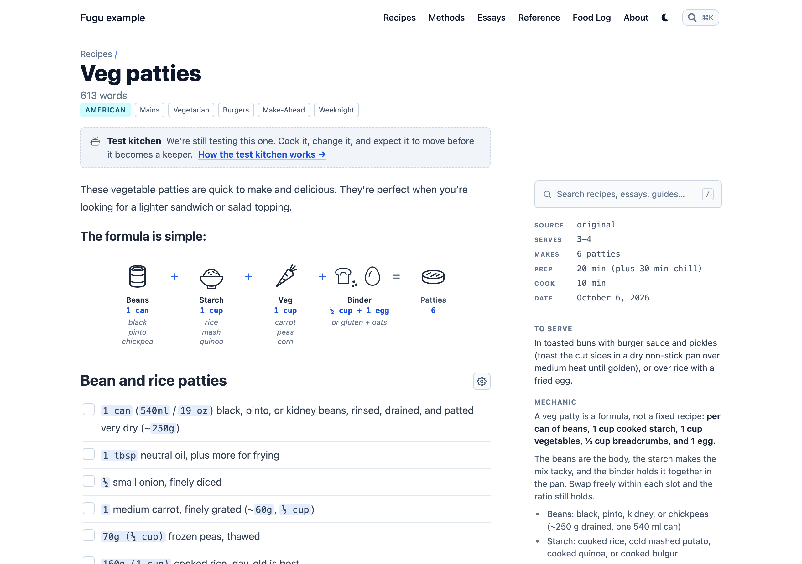
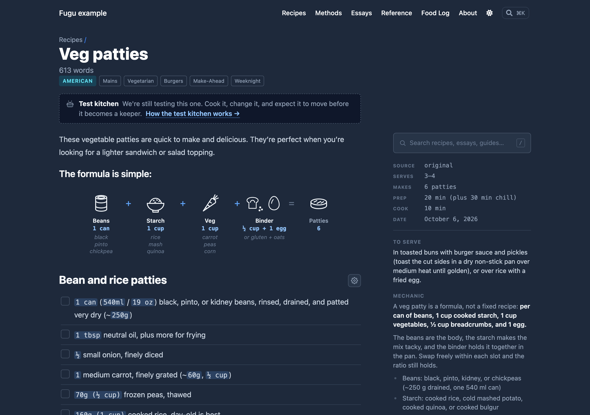
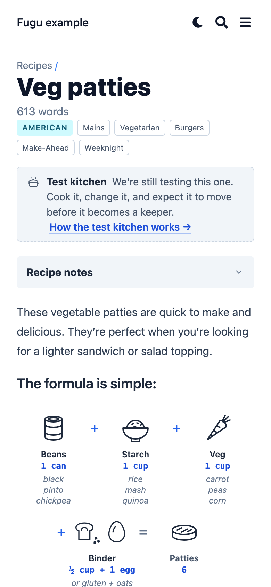
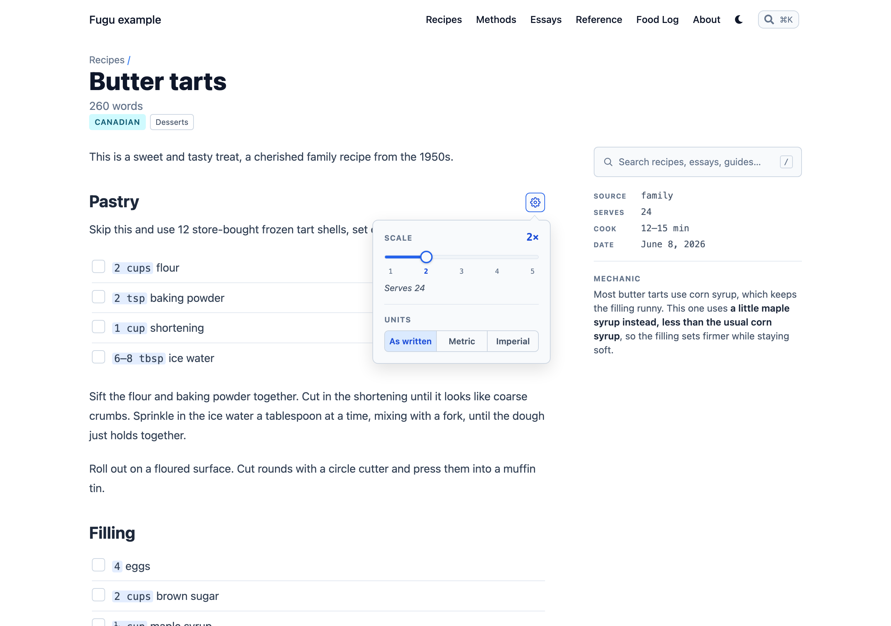
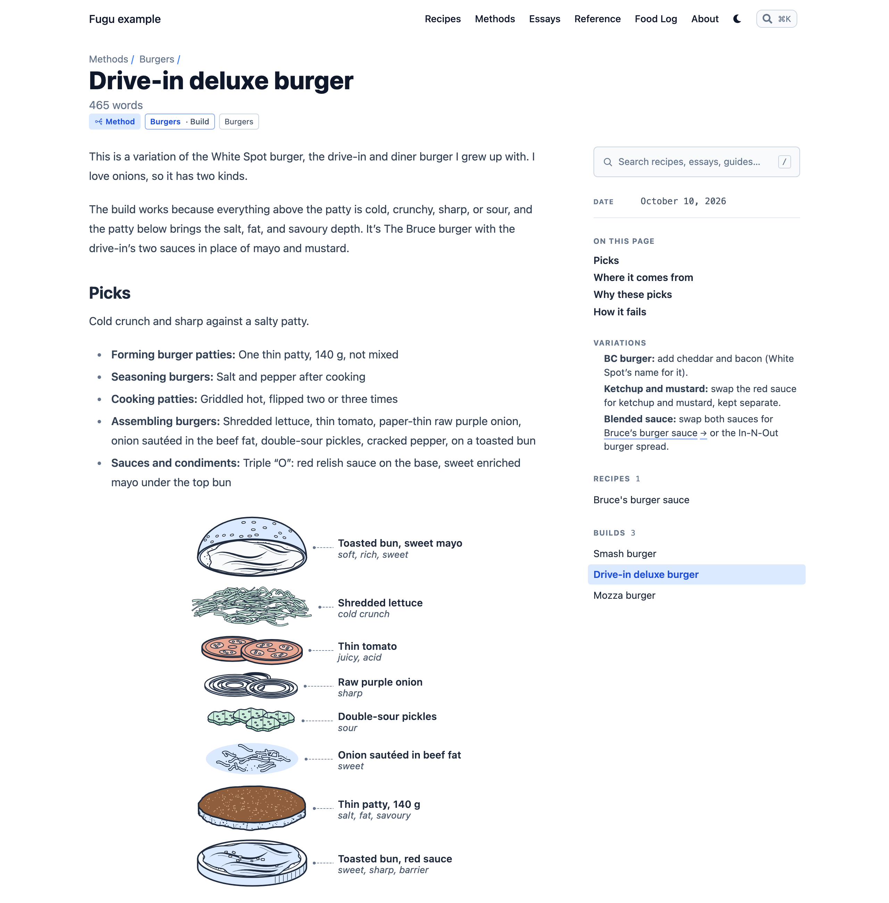
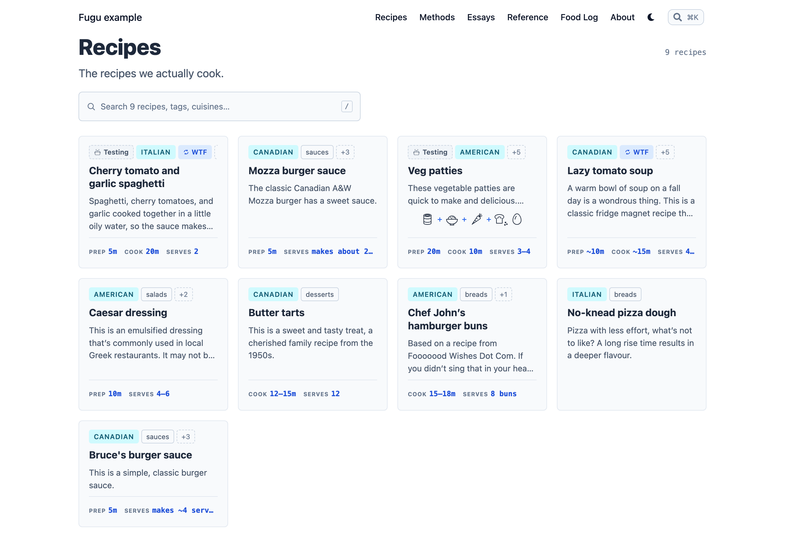
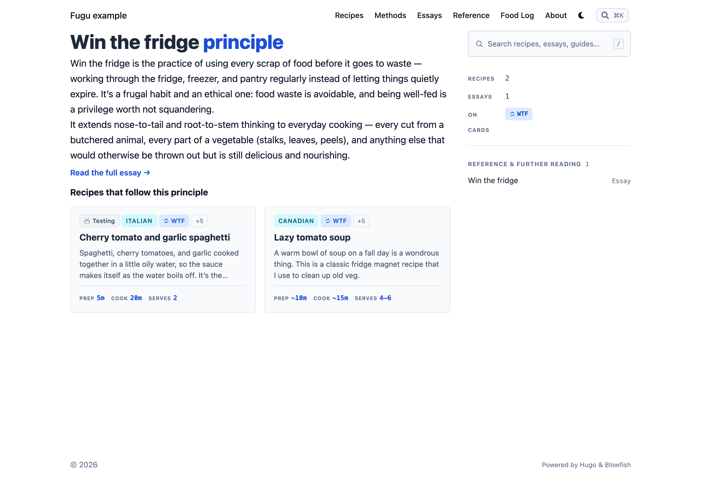
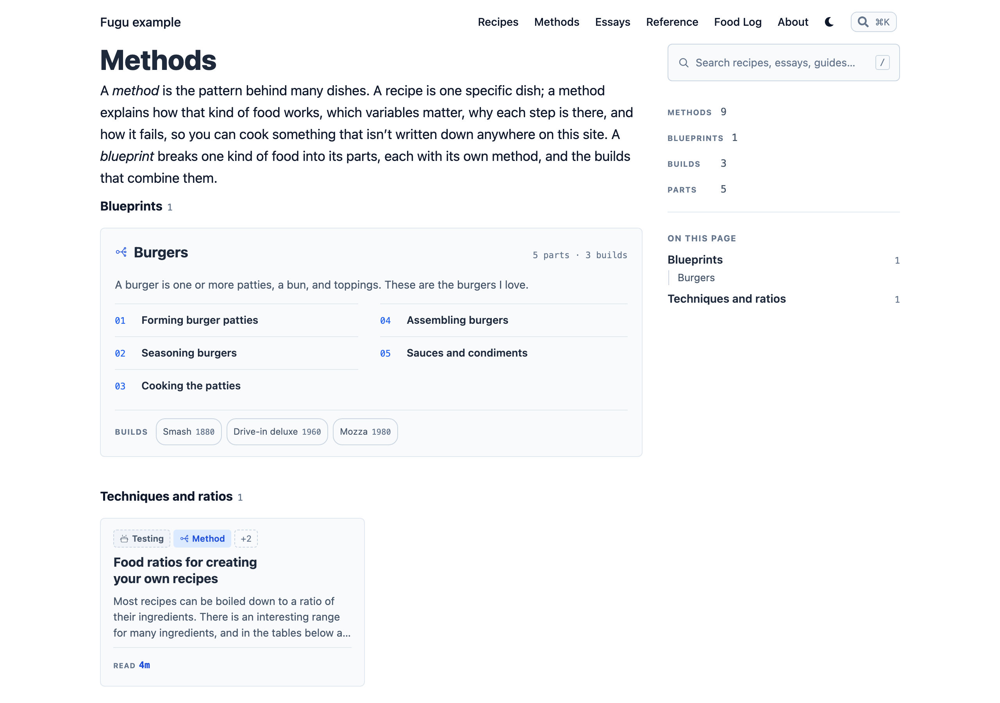
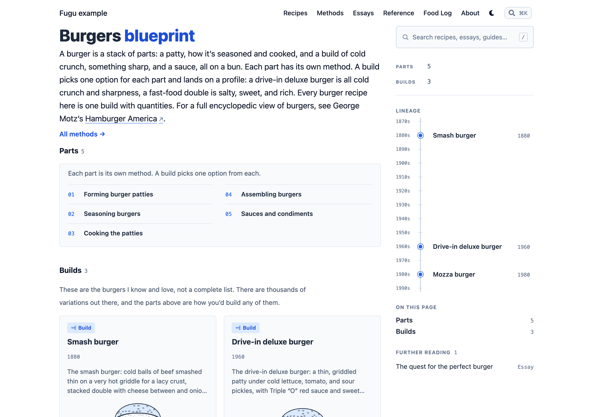

# Features

What Fugu adds to a Blowfish site, as a reader sees it. How to write each part is in [recipe-format.md](recipe-format.md) and [frontmatter.md](frontmatter.md); how to turn parts on, off, or rename them is in [configuration.md](configuration.md).

Everything here is built from plain Markdown. The interactive parts are small scripts with no dependencies, and every page still reads and prints with JavaScript off (see the end of this page).

## Recipe pages

A recipe page has two columns: the recipe itself, and a sidebar beside it.







The sidebar holds, top to bottom:

- The search box.
- The recipe's facts, from its frontmatter: Source, Aka, Serves, Makes, Prep, Cook, Total, Author, and the dates it was added and last updated. Only the ones a recipe sets are shown. A `source` that's a URL shows as a link to its site.
- The boxes the script moves out of the article: photos, To serve, Mechanic, Variations, Equipment, and Notes, in the order `recipeSidebar` sets. Empty boxes don't show.

That leaves the article with the intro, the ingredients, and the method, so the part you cook from is the part you scroll. On a phone the sidebar sits above the ingredients, closed behind a "Recipe notes" toggle.

Sections Fugu hides (`## History` by default) and blockquotes in the intro are hidden from readers but are still in the page's HTML. See [configuration.md](configuration.md#personal-notes).

### Photos

Photos written into the text are gathered into the sidebar as thumbnails (on a phone, a strip under the title), with a small "Photo 1" marker left where each one was. A thumbnail opens a viewer with the caption, the heading the photo sat under, and a link back to that spot in the text. Arrow keys step through the photos.

## Ingredients



Each line of an ingredient list gets a checkbox, so you can tick things off as you measure them. Ticks are saved in the browser, per recipe, and are still there when you come back.

The quantity at the start of each line is picked out, and a menu beside the first ingredients heading changes it:

- **Scale**: from 1× to 5×, in half steps. Every quantity on the page changes, including those in the method, and so do the Serves and Makes figures when they're numbers (`4`, `3–4`, `about 1.5 L`). A range widens outward rather than claiming more precision than the recipe has: 3–4 at 1.5× reads 4–6. Words such as "a pinch" don't scale.
- **Units**: As written, Metric, or Imperial. A line that gives both measures, `250 ml (1 cup)`, swaps which one leads. Temperatures in the method convert too, so `180°C` reads `350°F` in imperial.

The scale is saved per recipe; the unit choice is saved once for the whole site, since it's a reader's preference rather than a recipe's. A multi-component recipe has one menu that covers every component.

Conversion understands English unit words only (cups, tbsp, ounces, grams, and so on). An optional Kelvin setting exists, mostly as a joke: `params.recipe.enableKelvin`.

## Formula diagrams

A ```` ```formula ```` block draws a ratio or method as a row of icons, with a label, a quantity, and swaps under each one ([recipe-format.md](recipe-format.md#formula-diagrams); the full grammar is hugo-warped's [`fences/formula.md`](https://github.com/robotpony/hugo-warped/blob/main/fences/formula.md)). It appears in two places:

- **On the recipe page**, full size, where the block was written. A `:` ratio can add a bar showing the proportions.
- **On the recipe's card**, as a small strip of the icons and operators. For a ratio it keeps the numbers, since they're the point. Hovering a slot shows its label, quantity, and swaps.

The build warns about an icon name it doesn't know (and draws a dashed circle for it), a block that mixes operators, and a block with more than five slots.

### The icon kit

The icons are SVGs in `assets/icons/formula/`, one per name: bottle, bowl, breast, bun, butter, buttermilk, can, carrot, cheese, chicken, clock, cornmeal, crumbs, cup, egg, flame, flour, fruit, herb, honey, ice, jar, knife, lemon, lentils, mug, mustard, oats, oil, onion, oven, pan, patty, pepper, pickle, pot, potato, pounder, salt, soy, strainer, sugar, vinegar, water, wine. A site adds icons, or replaces Fugu's, by putting SVGs with those names in its own `assets/icons/formula/`. Icons are drawn in `currentColor`, so they follow the text colour in light and dark mode.

## Stack diagrams

A ```` ```stack ```` block draws a build as an exploded view: each layer from the side, pulled apart top to bottom, with a dotted leader to its label and role, and a `× n` bracket for repeated layers ([recipe-format.md](recipe-format.md#stack-diagrams); the full grammar is hugo-warped's [`fences/stack.md`](https://github.com/robotpony/hugo-warped/blob/main/fences/stack.md)). It appears full size where it's written, and the first one in a build also appears small and unlabelled on that build's card on its blueprint's page. The layers are SVGs in `assets/icons/layers/` (bun-top, bun-base, bread, lettuce, lettuce-shredded, slaw, lettuce-chunks, tomato, onion-raw, onion-fried, onion-minced, pickle, cheese, cheese-american, cheese-top, bacon, patty-thin, patty-thick (griddled), patty-thin-grilled, patty-thick-grilled, patty-smash, patty-chicken, sauce-ketchup-mustard, ketchup, sauce-burger, marinara, mustard, mayo, pasta, ragu, bechamel, and spreads drawn on the bun as pairs like `bun-base + mayo`), drawn in `currentColor` with the theme's soft accent and surface fills, fixed browns for a patty's seared top, and soft food colours for greens, tomato, ketchup, marinara, mustard and American cheese, so they follow light and dark mode. The build warns about a layer it doesn't know.



## Flow diagrams

A ```` ```flow ```` block draws a short sequence as boxed labels joined by arrows, each with a note under it, or up to three parallel rows lined up by step to compare them ([recipe-format.md](recipe-format.md#flow-diagrams); the full grammar is hugo-warped's [`fences/flow.md`](https://github.com/robotpony/hugo-warped/blob/main/fences/flow.md)). It's a formula's `→` sequence without icons, for steps that have none. In a narrow box, a phone or the recipe sidebar, each row becomes a list down the page.

## Wiki links and the glossary

`[[Title]]` links any page to any other by its title, as in Obsidian, so a recipe's ingredient list can link to the recipe for its sauce ([recipe-format.md](recipe-format.md#wiki-links)).

When no page has that title, the link can fall back to a definition:

- A link to a **reference essay** shows its summary in a popover, as well as linking to the essay.
- A link that matches a heading in the **glossary page** shows that entry in a popover.
- A link that matches nothing is marked as broken, so it's easy to find.

Popovers open on hover or keyboard focus, flip to whichever side of the window has room, and close with Escape. Setting up the glossary is in [configuration.md](configuration.md#glossary-and-reference-essays).

On essays and reference pages, the recipes a page links to are also listed in its sidebar.

## Cards and listings

The recipes list, tag and cuisine pages, the essay and reference lists, and the log list all use the same card. A recipe card shows:



- A top row of chips: the cuisine (linking to its page), any principle tag, then tags, with a count of the rest.
- The recipe's intro paragraph, or its frontmatter `summary` or `description`.
- The formula strip, if the recipe has a formula block.
- One line of facts: prep and cook times and servings, shortened to fit (`20m`, `1h`).

An essay card shows its folder (food memories, technique essays) in place of tags, and its reading time. A log card shows the month's opening paragraph and its number of days.

Tag and cuisine pages list 16 recipes to a page. A cuisine page is titled "Thai cuisine" rather than just "Thai". A tag or cuisine with its own `_index.md` can give its page a description, and the cuisine a shorter label for cards ([frontmatter.md](frontmatter.md#taxonomy-terms)).

## Pinned pages

`pinned: true` puts a page first: at the top of its section's list, of its tag and cuisine pages, and of search results, with a pin on its card. A pinned build leads its blueprint's builds everywhere but the lineage timeline, which stays in order of era. It's meant for a few pages that a reader should find first, not as a general way to sort ([frontmatter.md](frontmatter.md#pinned)).

## Principle tags

A tag can name an idea that several recipes follow, such as cooking from what's already in the fridge. Marked as a principle, the tag:



- Shows its definition in a callout at the top of its page, with a link to the essay that explains it.
- Lists only recipes in its grid, and everything else on the tag (essays, reference pages) under "Reference & further reading".
- Shows as a chip on recipe cards and pages, with its own icon if it names one. On a page, the chip has a popover that gives the definition. On a card, a principle can be its icon alone, which leaves room in the card's top row for another tag.

Setting one up is in [frontmatter.md](frontmatter.md#principle-tags).

## Methods and blueprints

Methods explain how a kind of food or a process works in general. Any page in the methods section, or in the essay section's methods folder, is one, and shows a method chip on its card and page (on the page, with a popover giving the definition). The methods section's page, or without one the method tag's page, is the methods list: the definition, then each blueprint with its parts in order as whole-row links, with its builds as a line of named pills under its parts (drafts dashed), then the methods that belong to no blueprint, as cards. Its sidebar has search, counts of methods, blueprints, builds and parts, "On this page", and anything else on the method tag as further reading.





A blueprint is a dish type made of parts, such as a burger: patty, seasoning, cooking, assembly, sauces. It's a folder under the methods, with its parts and builds in subfolders. Its page is on the reading layout, like the methods list, and shows:

- Its definition, from the folder's `_index.md`, with a link to the methods list.
- A lineage timeline: the builds placed by era, with drafts faint. At desktop widths it's in the sidebar, a vertical spine drawn to scale; narrower, a track of decades in the body (a list on a phone).
- Its parts in order, as numbered links, as on the methods list, under a line of lead text. Each part's description and options are on its own page.
- Its builds, the named combinations, as cards with their era, description, and stack diagram, oldest first, under an optional lead.
- In the sidebar: search, counts of parts and builds, the lineage, "On this page", and the pages linked from the `## Further reading` at the end of its definition.

A part or build gets a chip in its header that says where it sits: "Burgers · Burger patties" on a part, "Burgers · Build" on a build, linking to the blueprint. A part and a build end with navigation back to the blueprint and on to the next part or build, in place of the date-ordered previous and next.

The fields are in [frontmatter.md](frontmatter.md#methods-and-blueprints) and the settings in [configuration.md](configuration.md#methods-and-blueprints).

## Drafts

For a site that builds drafts, a draft is published as a page still in development, not hidden: a banner under its title, a mark on its card linking to the page that explains drafts, and an optional one-line note on what's being worked on. One page can explain how drafts work and list every current draft. The words are all settings ([configuration.md](configuration.md#drafts)).

## Essays, reference pages, and the log

These get a reading sidebar in place of the recipe one. It shows only what a page has:

- The search box, and the page's added and updated dates.
- Notes and photos, moved out of the article as on recipes.
- "On this page": the page's headings, grouped, on desktop. On a phone, Blowfish's own table of contents is used instead.
- The recipes the page links to.
- For an essay, the other essays in its folder. For a blueprint's part or build, the other parts or builds, in the blueprint's order.
- For a log month, its days, and the other months, newest first, with a day count for each.

A page at the site's root, such as About, can add "The cookbook in numbers" (counts of recipes, cuisines, essays, methods, and reference guides, each linking to its list) and a hand-picked "Start here" list ([frontmatter.md](frontmatter.md#pages-at-the-sites-root)).

## Search

Fugu uses Blowfish's search (`/` or ⌘K to open it), with one change: pinned pages come first among the results. It needs the home page's JSON output and `params.enableSearch` ([configuration.md](configuration.md#site-config-fugu-needs)). A recipe page's sidebar has a search box of its own that opens the same search.

## The recipe index

When the recipes section asks for it, Fugu writes `/recipes/index.json`: one entry per recipe, with its frontmatter facts, a word count, and whether it has a Mechanic, Variations, Notes, or a formula block. It's for scripts and tools that ask questions about the whole collection, such as which recipes have no cuisine, without parsing the content folder. The fields are listed in [frontmatter.md](frontmatter.md#in-recipesindexjson).

## Without JavaScript, and in print

Every page still works without JavaScript; it's just less arranged:

- Sections and photos stay where they were written, in the article, rather than moving to the sidebar.
- Ingredients are a plain list: no checkboxes, scaling, or unit menu.
- Popovers still open on hover and focus; they just don't flip or close with Escape.

In print, photos appear full size where they were written, not as thumbnails.
